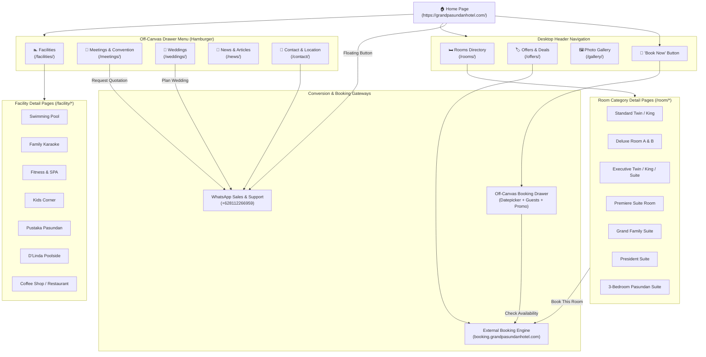
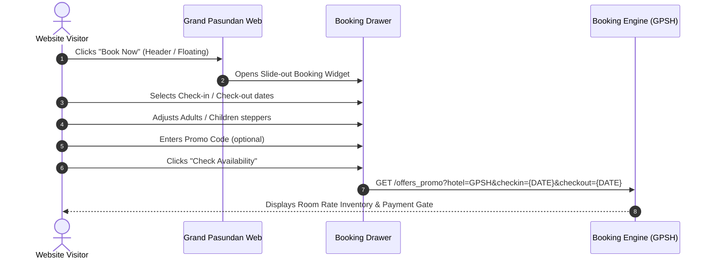
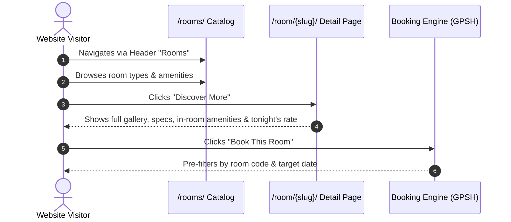
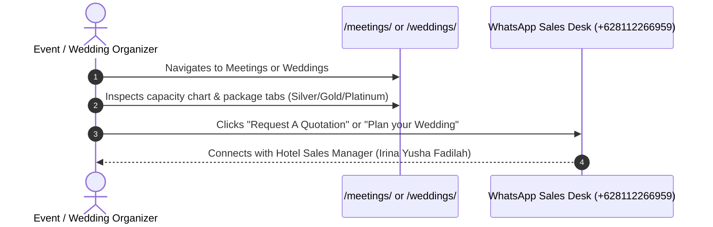

# Grand Pasundan Hotel — Website Navigation Tree & User Flow Architecture

> **Document Version:** 1.0.0  
> **Target Audience:** Autonomous Agents, AI Planners, Developers, System Architects  
> **Extraction Source:** Live browser inspection via Playwright MCP (`https://grandpasundanhotel.com/`)  
> **Verification Status:** All listed internal routes verified against live HTTP responses and DOM snapshots.

---

## 1. Executive Summary

This document provides a comprehensive map of the website information architecture, navigation paths, interactive trigger mechanisms, and user conversion flows for **Grand Pasundan Convention Hotel** (`https://grandpasundanhotel.com/`). 

### Core Architectural Findings
- **Platform Architecture:** WordPress CMS (Theme: `Alaric`) combined with a decoupled booking engine hosted on subdomain `booking.grandpasundanhotel.com` (Hotel Code: `GPSH`).
- **Dual Navigation Pattern:** 
  1. *Horizontal Desktop Header:* Exposes direct links to high-intent discovery pages (`Rooms`, `Offers`, `Gallery`) and triggers the booking modal.
  2. *Off-Canvas Drawer (Hamburger):* Houses the full institutional sitemap (`Home`, `Facilities`, `Meetings & Convention`, `Weddings`, `News`, `Contact`).
- **Sitewide Modals / Drawers:**
  - Off-canvas site navigation menu.
  - Off-canvas booking engine drawer with interactive calendar, guest increment steppers, and promo code field.
  - Floating direct WhatsApp inquiry button (`+628112266959`).

---

## 2. Complete Hierarchical Navigation Tree

```text
https://grandpasundanhotel.com/ (Home / Root) [CONFIRMED]
│
├── [Global Header / Primary Nav]
│   ├── /rooms/ (All Rooms Catalog) [CONFIRMED]
│   │   ├── /room/standard-twin/ [CONFIRMED]
│   │   ├── /room/standard-king/ [CONFIRMED]
│   │   ├── /room/deluxe-room-a-twin/ [CONFIRMED]
│   │   ├── /room/deluxe-room-a-king/ [CONFIRMED]
│   │   ├── /room/deluxe-b-twin/ [CONFIRMED]
│   │   ├── /room/deluxe-b-king/ [CONFIRMED]
│   │   ├── /room/executive-twin/ [CONFIRMED]
│   │   ├── /room/executive-king/ [CONFIRMED]
│   │   ├── /room/executive-suite-twin/ [CONFIRMED]
│   │   ├── /room/executive-suite-king/ [CONFIRMED]
│   │   ├── /room/premiere-suite-rooms/ [CONFIRMED]
│   │   ├── /room/grand-family-suite/ [CONFIRMED]
│   │   ├── /room/president-suite/ [CONFIRMED]
│   │   └── /room/3-bedroom-pasundan-suite/ [CONFIRMED]
│   ├── /offers/ (Special Offers & Flash Sales) [CONFIRMED]
│   ├── /gallery/ (Media Lightbox Gallery) [CONFIRMED]
│   └── [Action: "Book Now"] -> Triggers Off-Canvas Booking Drawer [CONFIRMED]
│
├── [Global Drawer / Side Navigation Menu]
│   ├── / (Home) [CONFIRMED]
│   ├── /facilities/ (Amenities Directory) [CONFIRMED]
│   │   ├── /facility/pustaka-pasunda/ (Library Lounge) [CONFIRMED]
│   │   ├── /facility/kids-corner/ (Play Area) [CONFIRMED]
│   │   ├── /facility/coffee-shop/ (Main Restaurant) [CONFIRMED]
│   │   ├── /facility/dlinda-poolside/ (Poolside Cafe) [CONFIRMED]
│   │   ├── /facility/pool/ (Swimming Pool) [CONFIRMED]
│   │   ├── /facility/fitness-spa/ (Gym & Wellness) [CONFIRMED]
│   │   └── /facility/family-karaoke/ (Entertainment) [CONFIRMED]
│   ├── /meetings/ (Meetings, Conventions & MICE) [CONFIRMED]
│   │   ├── Tab: Jayagiri Venue Rental [CONFIRMED]
│   │   ├── Tab: Half Malibu Venue Rental [CONFIRMED]
│   │   ├── Tab: Dome Malibu Venue Rental [CONFIRMED]
│   │   └── Action: "Request A Quotation" -> WhatsApp [CONFIRMED]
│   ├── /weddings/ (Wedding Packages & Venues) [CONFIRMED]
│   │   ├── Tab: Silver Package (Rp 135.000,- nett/pax) [CONFIRMED]
│   │   ├── Tab: Gold Package (Rp 180.000,- nett/pax) [CONFIRMED]
│   │   └── Tab: Platinum Package (Rp 230.000,- nett/pax) [CONFIRMED]
│   ├── /news/ (Press Releases & Seasonal Promos) [CONFIRMED]
│   └── /contact/ (Contact Information & Location Map) [CONFIRMED]
│       ├── Action: Google Maps Directions [CONFIRMED]
│       └── Action: Direct Email / Telephone [CONFIRMED]
│
├── [Global Floating & Action Triggers]
│   └── WhatsApp Floating Button: wa.me/628112266959 [CONFIRMED]
│
└── [External Conversion Endpoints]
    ├── https://booking.grandpasundanhotel.com/ (IBE Engine) [CONFIRMED]
    ├── https://www.instagram.com/grandpasundan (Social) [CONFIRMED]
    └── https://www.facebook.com/grandpasundanhotel (Social) [CONFIRMED]
```

---

## 3. Visual Architecture Diagram (Mermaid)



---

## 4. Route Directory & Verification Matrix

| Route / URI | Page Title / Purpose | Navigation Access Points | Status |
|---|---|---|---|
| `/` | Grand Pasundan Hotel (Homepage) | Global Logo, Drawer `Home`, Footer `Home` | **Confirmed** |
| `/rooms/` | Rooms Catalog & Overview | Header `Rooms`, In-page Links, Room Cards | **Confirmed** |
| `/offers/` | Special Offers & Flash Sales | Header `Offers`, Homepage Banner | **Confirmed** |
| `/gallery/` | Image Gallery & Lightboxes | Header `Gallery` | **Confirmed** |
| `/facilities/` | Facilities Overview | Drawer `Facilities`, Footer `Facilities` | **Confirmed** |
| `/meetings/` | Meetings & Convention | Drawer `Meetings`, Footer, Homepage Section | **Confirmed** |
| `/weddings/` | Wedding Packages & Venues | Drawer `Weddings`, Footer, Homepage Section | **Confirmed** |
| `/news/` | News, Press Releases, Promos | Drawer `News`, Footer `News` | **Confirmed** |
| `/contact/` | Contact, Address & Map | Drawer `Contact`, Footer `Contact` | **Confirmed** |
| `/room/standard-twin/` | Standard Twin Detail | `/rooms/`, Homepage Carousel | **Confirmed** |
| `/room/standard-king/` | Standard King Detail | `/rooms/`, Homepage Carousel | **Confirmed** |
| `/room/deluxe-room-a-twin/`| Deluxe A Twin Detail | `/rooms/`, Homepage Carousel | **Confirmed** |
| `/room/deluxe-room-a-king/`| Deluxe A King Detail | `/rooms/`, Homepage Carousel | **Confirmed** |
| `/room/deluxe-b-twin/` | Deluxe B Twin Detail | `/rooms/`, Homepage Carousel | **Confirmed** |
| `/room/deluxe-b-king/` | Deluxe B King Detail | `/rooms/`, Homepage Carousel | **Confirmed** |
| `/room/executive-twin/` | Executive Twin Detail | `/rooms/`, Homepage Carousel | **Confirmed** |
| `/room/executive-king/` | Executive King Detail | `/rooms/`, Homepage Carousel | **Confirmed** |
| `/room/executive-suite-twin/`| Executive Suite Twin | `/rooms/`, Homepage Carousel | **Confirmed** |
| `/room/executive-suite-king/`| Executive Suite King | `/rooms/`, Homepage Carousel | **Confirmed** |
| `/room/premiere-suite-rooms/`| Premiere Suite Room | `/rooms/`, Homepage Carousel | **Confirmed** |
| `/room/grand-family-suite/` | Grand Family Suite | `/rooms/`, Homepage Carousel | **Confirmed** |
| `/room/president-suite/` | President Suite | `/rooms/`, Homepage Carousel | **Confirmed** |
| `/room/3-bedroom-pasundan-suite/`| 3-Bedroom Pasundan Suite | `/rooms/`, Homepage Carousel | **Confirmed** |
| `/facility/pustaka-pasunda/` | Library & Cultural Lounge | `/facilities/`, Homepage Facilities | **Confirmed** |
| `/facility/kids-corner/` | Kids Play Area | `/facilities/`, Homepage Facilities | **Confirmed** |
| `/facility/coffee-shop/` | Main Restaurant | `/facilities/`, Homepage Facilities | **Confirmed** |
| `/facility/dlinda-poolside/`| Poolside Cafeteria | `/facilities/`, Homepage Facilities | **Confirmed** |
| `/facility/pool/` | Swimming Pool | `/facilities/`, Homepage Facilities | **Confirmed** |
| `/facility/fitness-spa/` | Gym & SPA Services | `/facilities/`, Homepage Facilities | **Confirmed** |
| `/facility/family-karaoke/`| Family Karaoke Rooms | `/facilities/`, Homepage Facilities | **Confirmed** |
| `https://booking.grandpasundanhotel.com/` | External Booking Engine | "Check Availability", "Book Now", "Book This Room" | **Confirmed** |
| `https://wa.me/08112266959` | Direct WhatsApp Channel | Floating Widget, Meeting Quotation, Contact Page | **Confirmed** |
| `/wp-admin/` | WordPress Backend | Hidden administrative route | *Unverified / Inaccessible* |

---

## 5. Interactive Elements & Trigger Behaviors

### 5.1 Global Header & Navigation Drawer
- **Hamburger Trigger (`link "menu"`):** Toggles CSS class to slide in the navigation drawer from the side.
  - Contains full institutional menu: `Home`, `Facilities`, `Meetings & Convention`, `Weddings`, `News`, `Contact`.
  - Close button (`×` / `javascript:void(0)`): Closes the drawer.
- **Top Quick Links:** Click navigates directly to `/rooms/`, `/offers/`, or `/gallery/`.
- **"Book Now" Button:** Opens the persistent off-canvas booking drawer.

### 5.2 Off-Canvas Booking Drawer
- **Trigger:** "Book Now" in header and floating bar.
- **Components:**
  - Date picker table (calendar grid) with interactive check-in / check-out selection.
  - Number steppers (`-` and `+` buttons) for:
    - Adults (Ages 18+) — Default: `2`
    - Children (Ages 0–17) — Default: `0`
  - Promo Code input field: `textbox "Enter promo code"`.
  - Form Submit (`button "Check Availability"`): Redirects to `booking.grandpasundanhotel.com` with URL query parameters pre-populated.

### 5.3 Carousels & Sliders
- **Hero Carousel:** 3 slides with `Previous`, `Next`, and slide indicator dots (`1`, `2`, `3`).
- **Homepage Rooms Carousel:** 14 room slides with individual `Discover More` links and slide pagination (`1` to `14`).
- **Homepage Facilities Carousel:** 7 items with direct `Discover` links.
- **Homepage Instagram Feed:** 12 items linked directly to Instagram posts and reels.

### 5.4 In-Page Tabs & Interactive Tables
- **`/meetings/` Venue Rental:** Interactive tablist (`Jayagiri`, `Half Malibu`, `Dome Malibu`) dynamically displaying room capacity, dimensions, ceiling height, AV specs, and rental pricing.
- **`/weddings/` Packages:** Interactive tablist (`Silver Package`, `Gold Package`, `Platinum Package`) detailing menu courses, benefits, and price per pax.

---

## 6. End-to-End User Conversion Flows

### Flow A: Direct Room Booking (Fast Path)


### Flow B: Room Browsing & Exploration Flow


### Flow C: MICE / Event & Wedding Inquiries


---

## 7. Actionable Architectural Insights for AI Agents

1. **Deterministic Room Slugs:** All room detail pages follow the schema `/room/{slug}/`. The singular `/room/` is used for detail pages, while plural `/rooms/` is used for the catalog overview.
2. **Deterministic Facility Slugs:** All facility pages follow `/facility/{slug}/`. Note the minor typo in the library slug: `/facility/pustaka-pasunda/` (omitted trailing 'n').
3. **No Direct Checkout on Primary Domain:** The primary site (`grandpasundanhotel.com`) does not host transactional or payment processing scripts. All checkouts are delegated to `booking.grandpasundanhotel.com` with parameter `hotel=GPSH`.
4. **Primary Real-time Conversion Channel:** High-touch conversions (corporate events, weddings, group stays) bypass web forms and route exclusively to direct WhatsApp communication (`08112266959`).
