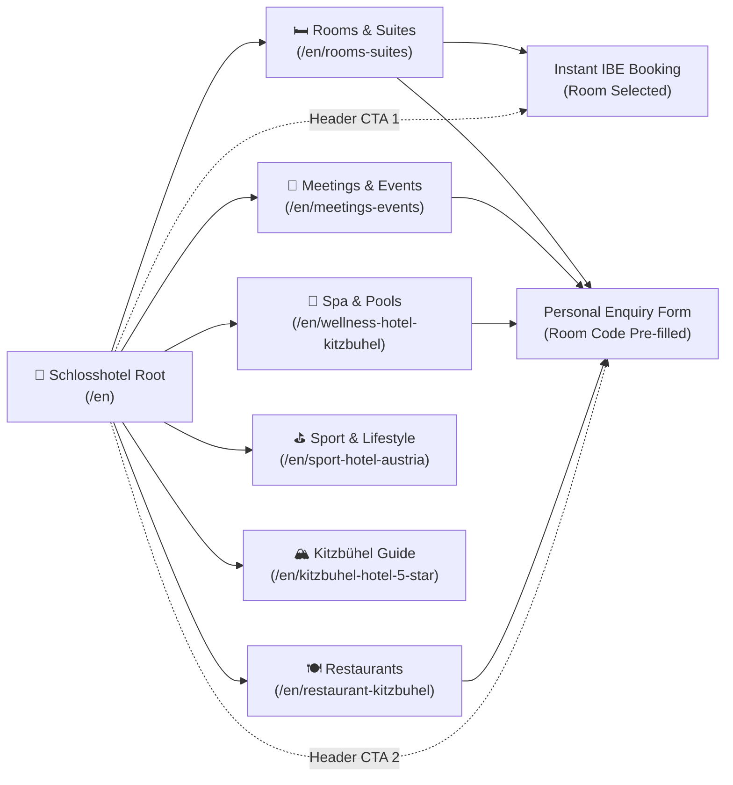
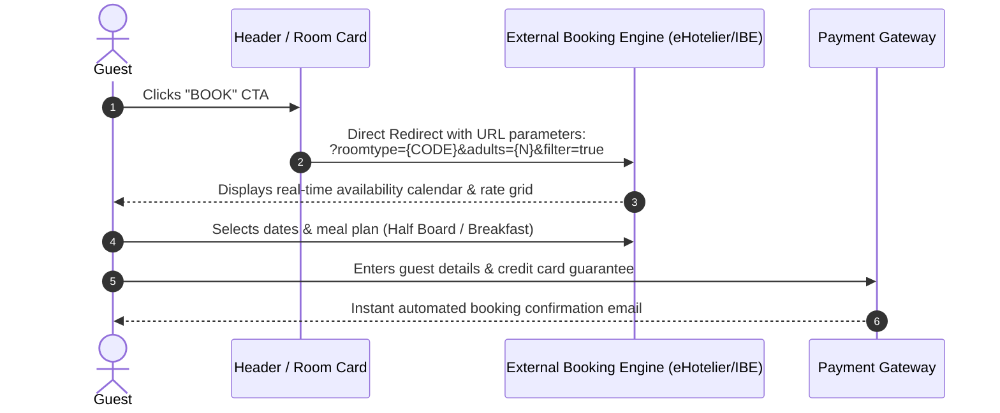
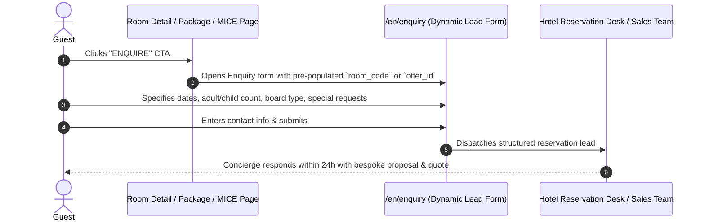

# Schlosshotel Kitzbühel — Reference Navigation Tree & User Flows

> **Document Version:** 1.0.0  
> **Source URL:** https://www.schlosshotel-kitzbuehel.com/en  
> **Purpose:** Structural benchmark for multi-tier luxury hospitality information architecture and dual-action booking conversion paths.

---

## 1. Information Architecture & Navigation Tree

The reference website organizes over 40+ pages into 8 clear thematic pillars, accessible via a full-screen drawer menu and contextual in-page discovery teasers.

```text
https://www.schlosshotel-kitzbuehel.com/en (Home / Root)
│
├── [Global Micro Header / Top Bar]
│   ├── /en/vouchers (Gift Vouchers & Packages)
│   ├── /en/enquiry (Structured Inquiry Form)
│   ├── tel:+435356656600 (Direct Hotel Concierge)
│   ├── Language Switcher: EN / DE
│   └── https://www.schlosshotel-kitzbuehel.com/booking/ (Direct IBE Engine)
│
├── [Desktop Quick Links (Header Right)]
│   ├── /en/wellness-hotel-kitzbuhel (Spa & Wellness)
│   ├── /en/rooms-suites (Rooms Catalog)
│   ├── /en/meetings-events (Conferences & Weddings)
│   ├── /en/photos (Visual Gallery)
│   └── /en/restaurant-kitzbuhel (Dining & Gastronomy)
│
├── [Full-screen Navigation Overlay Menu]
│   │
│   ├── 1. Kitzbühel (Destination & Positioning)
│   │   ├── /en/kitzbuhel-hotel-5-star (Hotel Overview)
│   │   ├── /en/family-hotel-tyrol (For Families)
│   │   ├── /en/sports-enthusiasts (For Sports Enthusiasts)
│   │   ├── /en/culture-lovers (For Culture Lovers)
│   │   └── /en/concierge-tips (Local Insider Tips)
│   │
│   ├── 2. Rooms and Suites (Accommodation)
│   │   ├── /en/rooms-suites (All Rooms & Suites Overview)
│   │   │   ├── /en/rooms-suites/rooms/classic-double-room
│   │   │   ├── /en/rooms-suites/rooms/comfort-double-room
│   │   │   ├── /en/rooms-suites/rooms/deluxe-double-room
│   │   │   └── /en/rooms-suites/rooms/comfort-double-room-with-balcony-or-terrace
│   │   ├── /en/arrangements (Special Packages)
│   │   └── /en/inclusive-services (Included Amenities)
│   │
│   ├── 3. Spa (Wellness Sanctuary)
│   │   ├── /en/wellness-hotel-kitzbuhel (Spa Main Portal)
│   │   ├── /en/day-spa (Day Spa Passes)
│   │   ├── /en/treatments (Signature Massages & Beauty)
│   │   └── /en/hotel-kitzbuhel-swimming-pool (Pool & Saunas)
│   │
│   ├── 4. Restaurants (Gastronomy)
│   │   ├── /en/restaurant-kitzbuhel (Culinary Overview)
│   │   ├── https://offers.schlosshotel-kitzbuehel.com/en/daskaps (DAS Kaps)
│   │   ├── https://offers.schlosshotel-kitzbuehel.com/en/rozusushi (Rōzu Sushi)
│   │   ├── /en/bar-lobby (Lounge Bar)
│   │   └── /en/restaurant-streif (Restaurant Streif)
│   │
│   ├── 5. Sport (Active Lifestyle)
│   │   ├── /en/sport-hotel-austria (Sports Main)
│   │   ├── /en/kitzbuhel-ski-hotel (Skiing & Winter)
│   │   ├── /en/golfhotel-kitzbuhel (9-Hole Golf Course)
│   │   ├── /en/austria-hiking-holidays (Hiking & Biking)
│   │   ├── /en/austria-walking-holidays (Leisure & Action)
│   │   └── /en/yoga-hotel-austria (Gym & Yoga Platform)
│   │
│   ├── 6. Meetings & Events (MICE & Celebrations)
│   │   ├── /en/meetings-events (Overview)
│   │   ├── /en/conference-hotel-austria (Corporate Conferences)
│   │   ├── /en/wedding-venue-austria (Castle Weddings)
│   │   └── /en/events-kitzbuhel (Castle Calendar & Annual Events)
│   │
│   ├── 7. By the Way (Guest Services & Practicalities)
│   │   ├── /en/kitzbuhel-holiday-children (Children Services)
│   │   ├── /en/dog-friendly-hotel-tyrol (Pet Friendly)
│   │   ├── /en/arrival (Directions & Map)
│   │   ├── /en/newsletter (Newsletter Signup)
│   │   └── /en/faqs (Frequently Asked Questions)
│   │
│   └── 8. Media & Journal
│       ├── /en/photos (High-Resolution Gallery)
│       ├── /en/social-media-wall (Instagram Wall)
│       └── /en/blog (Editorial Stories: Winter, Summer, Castle, Kitzbühel)
│
└── [Global Footer]
    ├── Contact & Physical Address
    ├── Careers (/en/career)
    ├── Social Profiles (Facebook, Instagram)
    ├── Legal Navigation (Imprint, Privacy, AGB, Accessibility, Sitemap)
    └── Partner & Association Badges
```

---

## 2. Mermaid Navigation Map



---

## 3. End-to-End User Conversion Flows

### Flow 1: High-Speed Instant Booking (Direct Revenue Path)
Used by independent leisure travelers with fixed dates and standard occupancy.



### Flow 2: Bespoke Consultation & Inquiry (High-Value Lead Path)
Used for luxury suites, corporate MICE bookings, wedding parties, or multi-family holidays requiring custom itineraries.



---

## 4. Key Takeaways for Grand Pasundan Hotel

1. **Hierarchy Discipline:** Even with 40+ pages, the main menu never feels overwhelming because primary topics are limited to 8 clean pillars, with secondary levels revealed only on hover or sub-navigation.
2. **Contextual Form Prefilling:** Every "Enquire" link carries URL parameters (`?room_code=SUPERIOR`, `?offer_id=107073`), ensuring the inquiry form knows exactly what the guest is interested in without asking them to re-enter details. Grand Pasundan can implement this directly for its 14 room types, 13 meeting rooms, and wedding packages.
3. **Preservation of Phone & Direct Contact:** The phone number (`Tel. +43...`) and direct inquiry form are always one click away, catering to corporate executive assistants and event planners who prefer direct human communication.
